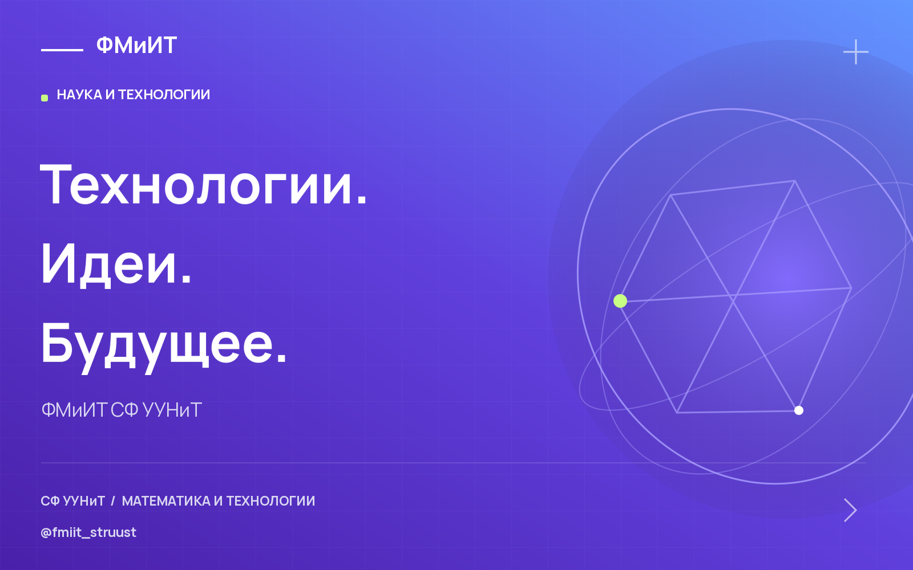

# ФМиИТ · Контент-студия

ВК-бот и веб-редактор для **ФМиИТ СФ УУНиТ** — факультета математики и информационных технологий Стерлитамакского филиала Уфимского университета науки и технологий.

Сообщество: [vk.ru/fmiit_struust](https://vk.ru/fmiit_struust), ID **157438856**. Фиолетово-синяя палитра, название и фирменные хештеги взяты из предоставленного сообщества. Обложки и интерфейс разработаны для этого проекта.



## Возможности

- Генерация русского текста через OpenAI-совместимый API: тема, проверенные факты, формат, тон и длина.
- Три оформления обложки: фирменное, технологичное и минималистичное. Экспорт PNG **1600 × 1000**, кириллица и локально поставляемый шрифт.
- Предпросмотр поста ВК, редактирование текста и обложки, копирование, сохранение и поиск черновиков.
- ВК-бот в личных сообщениях сообщества: текст, обложка, варианты, правки и подтверждение публикации.
- SQLite сохраняет черновики, состояние диалога и обработанные события между запусками.
- Симулятор диалога создаёт реальные локальные черновики и помогает проверить сценарии бота.

**Демо-режим** использует явно обозначенные шаблоны и работает без API-ключей. Для генерации нейросетью нужен действующий ключ провайдера. Для связи с ВК нужны токены и настройки сообщества; GitHub хранит код и сам по себе не запускает бота.

## Запуск

Нужны **Node.js 24.18+**, npm и Git. Docker и отдельная установка базы данных не требуются.

В PowerShell из папки проекта:

```powershell
npm ci
$env:GENERATION_MODE = "demo"
npm run build
npm start
```

Откройте **http://localhost:3001**. Сервер по умолчанию слушает только локальную машину.

Для разработки с автоматическим обновлением:

```powershell
$env:GENERATION_MODE = "demo"
npm run dev
```

Интерфейс: http://localhost:5173, API: http://localhost:3001. После изменения переменных окружения перезапустите процесс.

## Подключение нейросети

Провайдер должен поддерживать `POST /chat/completions`, JSON-ответ и выбранную модель. Используются `OPENAI_API_KEY`, `OPENAI_BASE_URL` и `OPENAI_MODEL`. Для официального OpenAI адрес — `https://api.openai.com/v1`.

Чтобы вводить секреты без отображения в терминале, определите функцию в текущем PowerShell:

```powershell
function Set-SecretEnvironment([string]$Name) {
    $secretValue = Read-Host $Name -AsSecureString
    $credential = New-Object System.Management.Automation.PSCredential("key", $secretValue)
    [Environment]::SetEnvironmentVariable($Name, $credential.GetNetworkCredential().Password, "Process")
}

Set-SecretEnvironment "OPENAI_API_KEY"
$env:OPENAI_BASE_URL = "https://api.openai.com/v1"
$env:OPENAI_MODEL = "gpt-4.1-mini"
$env:GENERATION_MODE = "ai"
npm start
```

Для другого провайдера укажите его адрес и доступную модель. HTTP 401/403 означает проблему ключа или доступа; 429 — ограничение провайдера. При ошибке нейросети приложение сообщает об этом, сохраняя предыдущие черновики.

Факты вводит редактор. Промпт запрещает выдумывать даты, места, результаты, имена и ссылки, но результат нейросети всё равно нужно проверить перед публикацией.

## Подключение ВК

Настройки выполняются владельцем или администратором сообщества.

1. В управлении сообществом включите **Сообщения**.
2. В **Работа с API → Ключи доступа** создайте ключ сообщества с правами сообщений и фото.
3. В **Long Poll API** включите Bots Long Poll, версию API **5.199** и событие **Входящее сообщение (`message_new`)**.
4. Укажите числовые VK ID редакторов в `VK_ADMIN_IDS`, через запятую. Другим пользователям бот не выдаёт черновики. В групповых беседах редакторские команды игнорируются.
5. Для публикации получите **отдельный пользовательский токен** администратора сообщества с правами `wall` и `photos`. Официальная схема VK требует пользовательский токен для `wall.post` и загрузки фото на стену; ключ сообщества для этих методов не подходит.

В PowerShell с функцией `Set-SecretEnvironment` из предыдущего раздела:

```powershell
$env:VK_GROUP_ID = "157438856"
Set-SecretEnvironment "VK_GROUP_TOKEN"
$env:VK_ADMIN_IDS = Read-Host "Числовые ID редакторов, через запятую"
Set-SecretEnvironment "VK_PUBLISH_TOKEN"
$env:VK_BOT_ENABLED = "true"
npm start
```

Откройте раздел **Подключение** в студии и нажмите **Проверить**. Статус «Бот на связи» появляется после успешного получения Long Poll. Отправьте **«начать»** в личные сообщения сообщества с разрешённого аккаунта.

Бот использует исходящие Long Poll запросы. Для самого бота публичный адрес и webhook не нужны. Если редакторы будут открывать студию с других устройств, настройте отдельный постоянный хостинг и `PUBLIC_URL`.

### Команды бота

| Команда | Действие |
|---|---|
| `начать`, `помощь` | Инструкция и клавиатура |
| `новый пост` | Бот запросит тему и факты |
| `пост <тема и факты>` | Сгенерировать и сохранить пост |
| `черновики` | Последние черновики и их ID |
| `открыть <id>` | Открыть сохранённый вариант; достаточно уникального начала ID |
| `текст <новый текст>` | Изменить основной текст текущего черновика |
| `обложка` | Получить фирменный PNG в диалоге |
| `ещё вариант` | Создать новый вариант по тому же заданию |
| `публиковать` | Получить предпросмотр и запрос подтверждения |
| `подтвердить` | Опубликовать подтверждённую версию |
| `отмена` | Отменить действие, сохранив черновик |

В веб-симуляторе сообщения и публикации во ВК не отправляются.

## Подтверждение и сбои публикации

Подтверждение действует **10 минут** и связано с конкретной ревизией. Правка, в том числе другим редактором, аннулирует соответствие предпросмотру. Для каждой публикации используется постоянный `guid` ВК; опубликованный локальный пост защищён от повторной отправки.

Если ВК явно отклонил запрос до публикации, черновик остаётся доступным для правок. Если ответ потерян после отправки или процесс был прерван, приложение показывает **«Нужна проверка»** и сохраняет исходный вариант без возможности редактировать его. Проверьте стену сообщества. Повтор подтверждается вручную и отправляет тот же текст с тем же ID; автоматических повторов `wall.post` нет. После перезапуска незавершённые отправки переходят в этот же режим проверки.

## Доступ к студии

Для работы по сети нужен пароль редактора минимум **12 символов**. Для сохранения сессий между перезапусками задайте `SESSION_SECRET` минимум **32 символа**. Пустое значение безопасно заменяется случайным секретом, поэтому при перезапуске понадобится новый вход.

```powershell
Set-SecretEnvironment "ADMIN_PASSWORD"
Set-SecretEnvironment "SESSION_SECRET"
$env:HOST = "0.0.0.0"
$env:PUBLIC_URL = "https://studio.example.com"
npm start
```

Публичную установку обслуживайте через HTTPS reverse proxy. Cookie сессии — HttpOnly / SameSite=Strict; запись через API проверяет источник запроса. Запускайте один процесс бота на одну базу SQLite.

Токены и пароли задаются переменными окружения. Они не попадают в API-ответы или браузерный JavaScript. `.env.example` содержит пустые значения для справки. `.env`, `data/`, зависимости и сборка исключены из Git.

## Проверки

```powershell
npm run verify
npm audit
```

Проверяются TypeScript, поведение генератора, авторизация, хранение данных, подтверждения ревизий, защита повторов, восстановление после прерывания, формат запросов ВК, диалог бота, размеры PNG, линтер и сборка. API-тесты используют локальные имитации и не отправляют посты в настоящее сообщество.

Для отдельной проверки окна публикации есть `npx tsx tests/browser-fixture.ts` на http://localhost:3031. Он имитирует потерянный ответ первого запроса и успешный повтор, хранит данные в памяти и не обращается к ВК.

Пример GitHub Actions: [docs/github-actions.yml](docs/github-actions.yml). Его можно установить как `.github/workflows/checks.yml`, когда GitHub-авторизация разрешает изменение workflows.

## Структура

```text
server/           API, генерация, SQLite, обложки, ВК и публикация
src/              Веб-студия на React
shared/           Контракты и валидация
tests/            Проверки и локальный браузерный стенд
assets/fonts/     Manrope и лицензия SIL Open Font License
public/brand/     Аватар и обложка исходного сообщества
docs/             Дизайн, план, примеры и результаты проверок
data/             Локальная SQLite, создаётся при запуске и не коммитится
```

Новые примеры всех обложек можно создать командой `npm run examples`.
